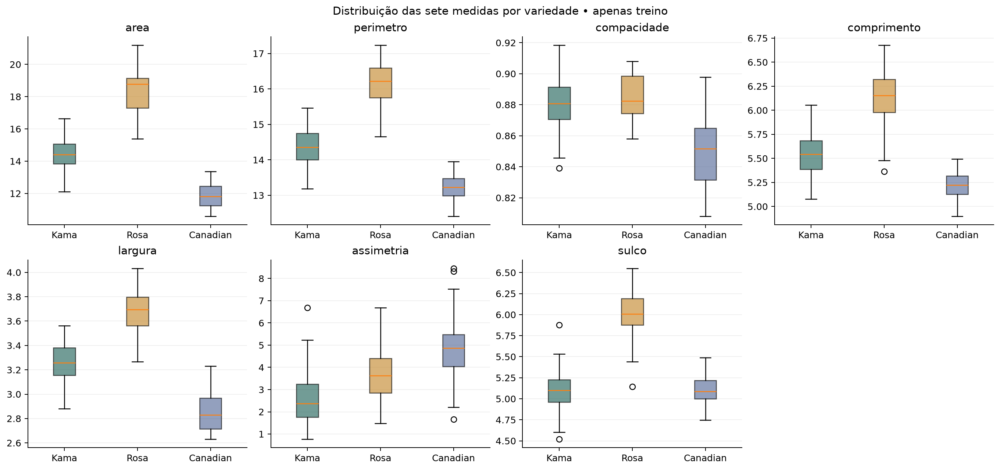

# Entrega de 13/11/2026 - Preparação, EDA e seleção

Material preparado antecipadamente em 06/11/2026. A data no título identifica o marco do cronograma, não uma execução futura já ocorrida. Não houve envio à plataforma da disciplina.

## Procedimento e resultados observados

Auditoria executada: 210 linhas, sete medidas contínuas e uma classe nominal codificada por inteiro. Zero ausentes, zero duplicatas de linhas ou de X, zero valores não finitos e zero medidas não positivas. O arquivo foi lido com `pandas.read_csv(sep=r"\s+", header=None)`, nomes explícitos e conversão numérica validada. Nenhum registro foi removido ou valor corrigido. O bruto mantém o mesmo SHA-256 antes e depois.

Colunas: `area`, `perimetro`, `compacidade`, `comprimento`, `largura`, `assimetria`, `sulco`, `classe`. Identificador rastreável: `linha_origem`, contado a partir de 1. A fonte UCI não explicita unidades físicas na tabela consultada. Não atribuímos unidades por suposição. A discrepância máxima entre compacidade informada e 4πA/P² foi 0,001020. Esse diagnóstico isolado não justifica recalcular medidas do original.

A divisão estratificada 80/20, semente 42, precede EDA e seleção supervisionada. São 168 exemplos de treino (56 por classe) e 42 de teste (14 por classe). Validação cruzada estratificada de cinco folds, com embaralhamento e semente 42, usa apenas treino. O seletor SelectKBest com ANOVA f_classif fica no Pipeline e reaprende as colunas em cada fold. Não há normalização no classificador de árvore, imputação ou reamostragem. As classes já estão equilibradas. Os códigos 1, 2, 3 são categorias, sem ordem quantitativa.

A EDA usa somente os 168 grãos de treino. A correlação de Pearson entre área e perímetro foi 0,9945. Essa redundância ajuda a explicar por que escolher apenas os três maiores escores univariados pode descartar informação complementar. O critério de 1,5 IQR sinalizou quatro valores de compacidade e dois de assimetria, em seis grãos. Mantivemos esses registros por não existir evidência de erro de medição. No treino, a média da área foi 14,43 em Kama, 18,36 em Rosa e 11,87 em Canadian, enquanto a média da assimetria foi 2,58, 3,66 e 4,82, respectivamente. Há sobreposição entre distribuições.

| Atributo | F ANOVA no treino | Candidato k=3 |
| --- | --- | --- |
| area | 466,65 | Sim |
| perimetro | 464,78 | Sim |
| largura | 347,07 | Sim |
| sulco | 302,30 | Não |
| comprimento | 275,49 | Não |
| compacidade | 57,79 | Não |
| assimetria | 45,73 | Não |

Os candidatos iniciais são área, perímetro e largura. O ranking ANOVA é um filtro univariado exploratório, não uma conclusão causal nem garantia de melhor subconjunto. Seus valores-p não foram usados como inferência confirmatória após seleção. O número final de atributos depende da validação posterior.

## Arquivos produzidos

`dados/seeds_tratado.csv`, `dados/X_treino.csv`, `dados/y_treino.csv`, `dados/X_teste.csv`, `dados/y_teste.csv`; `resultados/validacao_dados.json`, `particoes.csv`, `limites_iqr_treino.csv`, `extremos_iqr_treino.csv`, `resumo_treino.csv`, `resumo_por_classe_treino.csv`, `correlacao_treino.csv`, `ranking_atributos_treino.csv`; gráficos 01 a 06 em PNG e SVG. Os nomes sem diretório nesta lista pertencem a `resultados/`.

## Próximos passos do cronograma

Em 20/11, comparar referência e árvores por validação no treino. O teste fica reservado. As etapas posteriores já foram executadas antecipadamente e estão registradas nas respectivas entregas.
