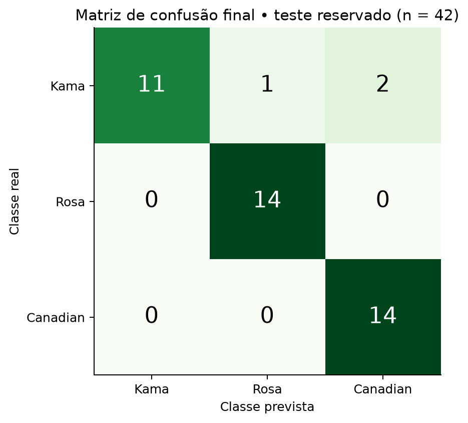

# Entrega de 27/11/2026 - Refinamento e análise dos erros

Material preparado antecipadamente em 06/11/2026. A data no título identifica o marco do cronograma, não uma execução futura já ocorrida. Não houve envio à plataforma da disciplina.

## Ajustes com treino e validação

A busca testa 240 configurações e 1.200 ajustes de validação: k em [2,3,4,5,6,all], profundidade em [2,3,4,5,None], folha mínima em [1,2,4,6] e ccp_alpha em [0,0.01]. F1 macro médio escolhe a configuração. Empates numéricos usam acurácia, menos atributos, menor profundidade, maior folha mínima e maior poda, nessa ordem. A comparação usa os mesmos folds. O melhor resultado de CV é um critério de seleção e pode ser otimista após a busca. O desvio padrão entre folds não é um intervalo de confiança.

A configuração escolhida aceita os sete atributos, usa Gini, max_depth=5, min_samples_leaf=1, ccp_alpha=0.01 e random_state=42. A árvore resultante tem 5 níveis de profundidade e 8 folhas. Seus cortes efetivos usam área, comprimento, largura, assimetria e sulco. Perímetro e compacidade continuam na entrada, mas não aparecem nos cortes da árvore final.

| Modelo | Acurácia CV | F1 macro CV | DP F1 macro |
| --- | --- | --- | --- |
| Referência simples | 32,75% | 0,1644 | 0,0018 |
| Árvore inicial (7) | 89,86% | 0,8984 | 0,0406 |
| Árvore inicial (k=3) | 83,33% | 0,8340 | 0,0488 |
| Árvore refinada | 92,26% | 0,9231 | 0,0527 |

## Avaliação final no teste reservado

A árvore refinada acertou 39 de 42 grãos: acurácia 92,86% e F1 macro 0,9263. A referência sempre prevê Kama no treino completo e acerta 14/42 (33,33%). O ganho foi de 59,52 pontos percentuais. O intervalo de Wilson de 95% da acurácia é 80,99% a 97,54%, sob aproximação binomial para este teste. AUC macro um-contra-resto: 0,9226. AUC mede ordenação dos escores, não a taxa de acertos.

| Modelo | Acurácia treino | Acurácia teste | F1 macro teste | Acertos |
| --- | --- | --- | --- | --- |
| Referência simples | 33,33% | 33,33% | 0,1667 | 14/42 |
| Árvore inicial (7) | 100,00% | 88,10% | 0,8766 | 37/42 |
| Árvore inicial (k=3) | 100,00% | 83,33% | 0,8226 | 35/42 |
| Árvore refinada | 98,81% | 92,86% | 0,9263 | 39/42 |

| Classe | Precisão | Recall | F1 | Suporte |
| --- | --- | --- | --- | --- |
| Kama | 100,00% | 78,57% | 0,8800 | 14 |
| Rosa | 93,33% | 100,00% | 0,9655 | 14 |
| Canadian | 87,50% | 100,00% | 0,9333 | 14 |

Precisão = acertos entre as previsões da classe. Recall = acertos entre os exemplos reais da classe. F1 combina precisão e recall. F1 macro dá o mesmo peso às três classes. Suporte é a quantidade real no teste. A referência tem precisão/recall/F1 zero nas classes nunca previstas, com `zero_division=0` declarado.

Matriz com linhas reais e colunas previstas:

| Real / previsto | Kama | Rosa | Canadian |
| --- | --- | --- | --- |
| Kama | 11 | 1 | 2 |
| Rosa | 0 | 14 | 0 |
| Canadian | 0 | 0 | 14 |

## Erros observados

| Linha do bruto | Real | Previsto | Folha | Grãos de treino na folha |
| --- | --- | --- | --- | --- |
| 24 | Kama | Canadian | 5 | 48 |
| 62 | Kama | Canadian | 5 | 48 |
| 38 | Kama | Rosa | 13 | 1 |

Todos os erros finais são Kama: dois classificados como Canadian e um como Rosa. As linhas 24 e 62 caem na mesma região de área pequena e sulco acima de 4,675, com folha formada por 48 Canadian no treino. Os vizinhos nos sete atributos incluem ambas as classes. A linha 38 tem área 17,08 e largura 3,683 e alcança uma folha Rosa formada por apenas um grão de treino. Isso evidencia fragilidade local da árvore. As proporções de classe nas três folhas erradas são 100% para a classe prevista, mostrando que pureza de folha não equivale a certeza de acerto. Não há evidência para atribuir os erros a defeitos, rótulos incorretos ou causas biológicas. O diagnóstico é descritivo e não gerou novo ajuste após consultar o teste.

### Linha 24: Kama classificada como Canadian

Caminho observado: sulco=4.961 <= 5.5755; area=12.08 <= 13.435; area=12.08 <= 12.71; sulco=4.961 > 4.675. Folha 5, com 48 exemplos de treino. Proporções de classes 1, 2, 3 nessa folha: [0.0, 0.0, 1.0].

Três vizinhos no treino, por distância euclidiana nos sete atributos padronizados com estatísticas somente do treino: linha 65, classe 1, distância 0,726; linha 166, classe 3, distância 0,774; linha 31, classe 1, distância 1,088. Esse diagnóstico não altera o classificador.

### Linha 62: Kama classificada como Canadian

Caminho observado: sulco=4.703 <= 5.5755; area=11.23 <= 13.435; area=11.23 <= 12.71; sulco=4.703 > 4.675. Folha 5, com 48 exemplos de treino. Proporções de classes 1, 2, 3 nessa folha: [0.0, 0.0, 1.0].

Três vizinhos no treino, por distância euclidiana nos sete atributos padronizados com estatísticas somente do treino: linha 166, classe 3, distância 1,024; linha 63, classe 1, distância 1,111; linha 202, classe 3, distância 1,171. Esse diagnóstico não altera o classificador.

### Linha 38: Kama classificada como Rosa

Caminho observado: sulco=5.484 <= 5.5755; area=17.08 > 13.435; largura=3.683 > 3.572. Folha 13, com 1 exemplos de treino. Proporções de classes 1, 2, 3 nessa folha: [0.0, 1.0, 0.0].

Três vizinhos no treino, por distância euclidiana nos sete atributos padronizados com estatísticas somente do treino: linha 36, classe 1, distância 0,934; linha 80, classe 2, distância 1,010; linha 102, classe 2, distância 1,113. Esse diagnóstico não altera o classificador.

## Limitações

O teste contém apenas 42 exemplos e uma única divisão. Um erro representa 2,38 pontos percentuais de acurácia e 7,14 pontos no recall de uma classe. Não há avaliação em nova safra, local, instrumento ou protocolo de medição. A UCI descreve coleta em campos experimentais em Lublin. A hipótese fica sustentada nesta divisão, sem demonstrar desempenho universal, causalidade ou superioridade sobre todos os classificadores. A busca escolheu uma folha mínima de 1, mantendo risco local mesmo com poda. O teste já consultado não serve como avaliação inédita de versões futuras. Não fizemos teste formal de significância nem apresentamos um valor-p como prova da hipótese.

## Arquivos produzidos e próximos passos

`resultados/busca_hiperparametros.csv`, `modelo_congelado.json`, `comparacao_teste.csv`, `previsoes_teste.csv`, `erros_teste.csv`, `erros_detalhados.json`, `resumo_execucao.json`, `importancias_arvore_final.csv`; métricas por classe e matrizes de confusão de cada modelo em CSV; gráficos 07 a 10; `modelos/seeds_arvore.joblib` e `modelos/regras_arvore.txt`. Os nomes sem diretório nesta lista pertencem a `resultados/`.

Para 04/12, consolidar relatório, apresentação, demonstração local de inferência e plano de monitoramento. O modelo permanece congelado após esta avaliação.
