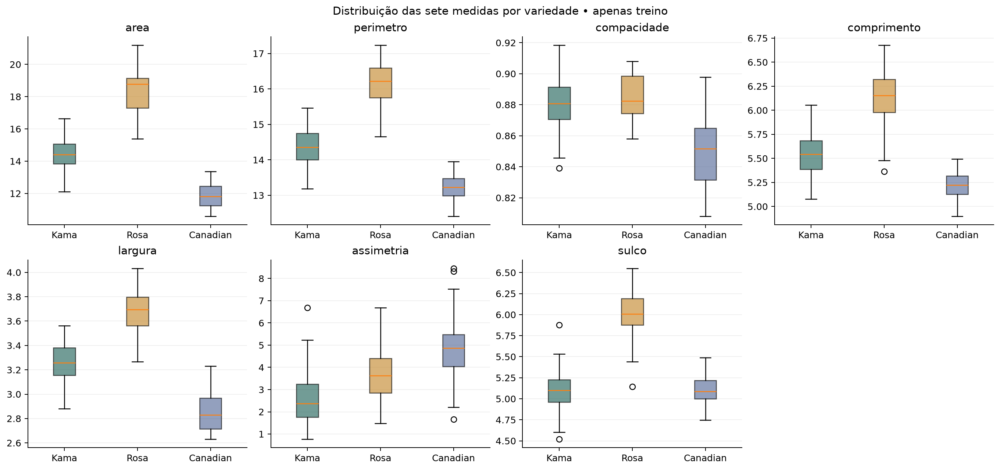
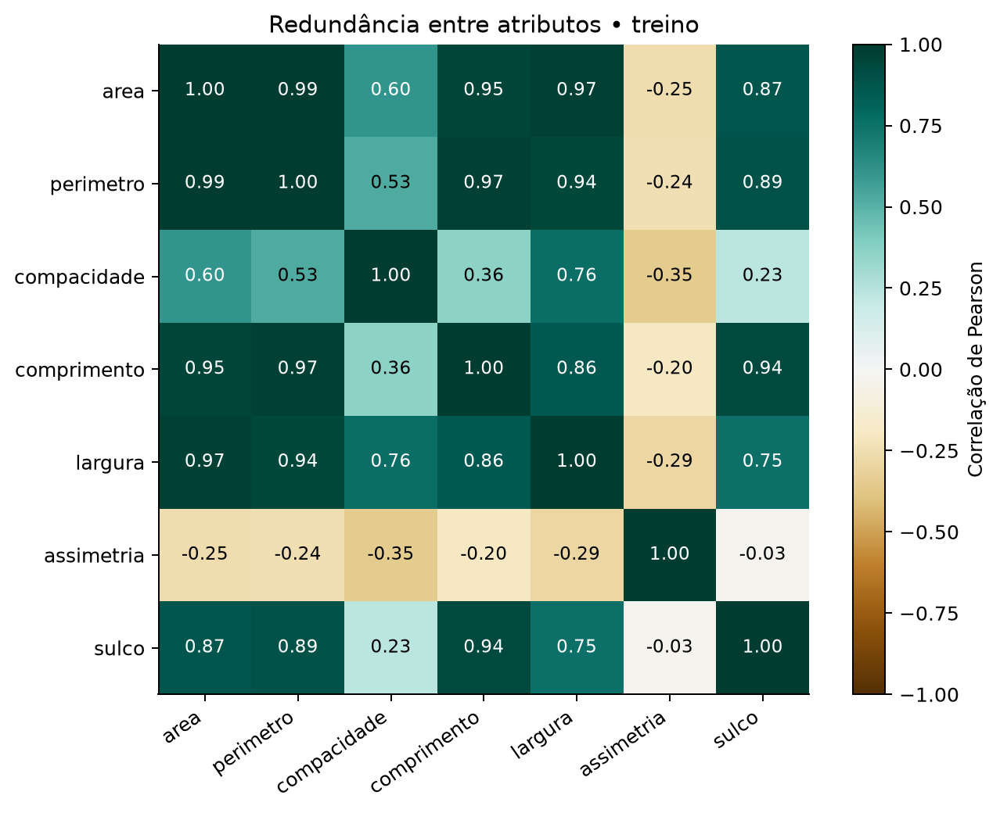
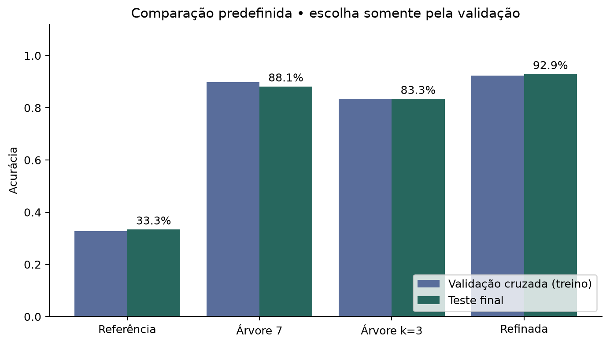
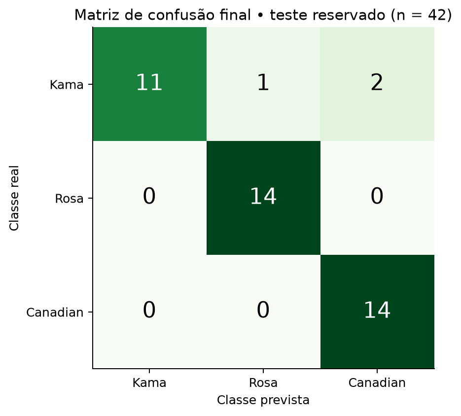
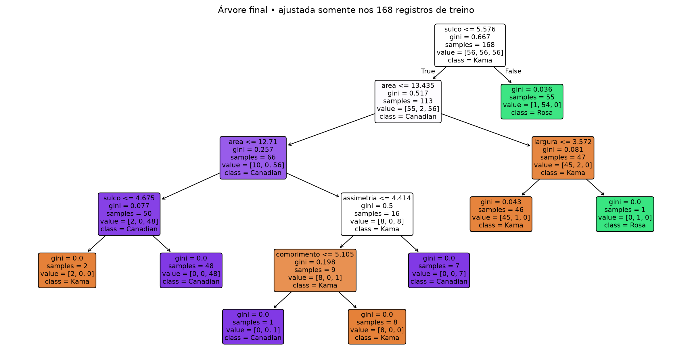

# AV2 Seeds - Relatório final

Gabriel Felix. Execução antecipada em 06/11/2026. Entrega final prevista: 04/12/2026.

## 1. Problema, pergunta e hipótese

As sete características geométricas do dataset Seeds permitem prever a variedade de um grão de trigo?

Classificação supervisionada multiclasse: sete medidas como X, variedade como y. Hipótese preservada: superar uma regra que sempre prevê uma única classe. Acurácia da referência equilibrada esperada: cerca de 33,3%. A métrica de seleção é F1 macro, com acurácia e métricas por classe para comunicar o resultado.

A árvore refinada acertou 39 de 42 grãos: acurácia 92,86% e F1 macro 0,9263. A referência sempre prevê Kama no treino completo e acerta 14/42 (33,33%). O ganho foi de 59,52 pontos percentuais. O intervalo de Wilson de 95% da acurácia é 80,99% a 97,54%, sob aproximação binomial para este teste. AUC macro um-contra-resto: 0,9226. AUC mede ordenação dos escores, não a taxa de acertos.

## 2. Origem e auditoria

Dados: Charytanowicz et al. (2010), Seeds, UCI, DOI 10.24432/C5H30K, CC BY 4.0. A ficha UCI informa os nomes, mas não explicita o mapa dos códigos. A documentação mantida pelos autores do ODRF confirma 1=Kama, 2=Rosa, 3=Canadian. Ela descreve uma versão de 209 linhas, usada aqui apenas para o mapa semântico. Toda a análise usa as 210 linhas do bruto local da UCI.

Auditoria executada: 210 linhas, sete medidas contínuas e uma classe nominal codificada por inteiro. Zero ausentes, zero duplicatas de linhas ou de X, zero valores não finitos e zero medidas não positivas. O arquivo foi lido com `pandas.read_csv(sep=r"\s+", header=None)`, nomes explícitos e conversão numérica validada. Nenhum registro foi removido ou valor corrigido. O bruto mantém o mesmo SHA-256 antes e depois.

SHA-256: `1f3f83c0d8485ae9148061389d19628607e3f5660e3d6f40ec9102fb398bb12f`.

Entradas: área, perímetro, compacidade, comprimento, largura, assimetria e comprimento do sulco, nesta ordem. Não há unidades físicas explicitadas na ficha consultada. A compacidade é relacionada a 4πA/P², e a maior diferença observada foi 0,001020. Nenhum valor foi recalculado. `linha_origem` identifica a linha física do bruto a partir de 1 e não entra no modelo. `variedade` e `particao` também ficam fora de X.

## 3. Preparação e divisão

A divisão estratificada 80/20, semente 42, precede EDA e seleção supervisionada. São 168 exemplos de treino (56 por classe) e 42 de teste (14 por classe). Validação cruzada estratificada de cinco folds, com embaralhamento e semente 42, usa apenas treino. O seletor SelectKBest com ANOVA f_classif fica no Pipeline e reaprende as colunas em cada fold. Não há normalização no classificador de árvore, imputação ou reamostragem. As classes já estão equilibradas. Os códigos 1, 2, 3 são categorias, sem ordem quantitativa.

`dados/seeds_tratado.csv` organiza dados e metadados. Os CSV de X/y preservam `linha_origem` como índice, que deve ser retirado das entradas. O código realiza essa exclusão explicitamente. As quantidades globais e a qualidade são conferidas para todo o bruto, enquanto gráficos e decisões exploratórias usam só treino.

## 4. Análise exploratória e seleção

A EDA usa somente os 168 grãos de treino. A correlação de Pearson entre área e perímetro foi 0,9945. Essa redundância ajuda a explicar por que escolher apenas os três maiores escores univariados pode descartar informação complementar. O critério de 1,5 IQR sinalizou quatro valores de compacidade e dois de assimetria, em seis grãos. Mantivemos esses registros por não existir evidência de erro de medição. No treino, a média da área foi 14,43 em Kama, 18,36 em Rosa e 11,87 em Canadian, enquanto a média da assimetria foi 2,58, 3,66 e 4,82, respectivamente. Há sobreposição entre distribuições.





| Atributo | F ANOVA no treino | Candidato k=3 |
| --- | --- | --- |
| area | 466,65 | Sim |
| perimetro | 464,78 | Sim |
| largura | 347,07 | Sim |
| sulco | 302,30 | Não |
| comprimento | 275,49 | Não |
| compacidade | 57,79 | Não |
| assimetria | 45,73 | Não |

O ranking é descritivo, ajustado somente no treino. Os valores-p exploratórios ficam no CSV e não foram usados para uma afirmação confirmatória. Filtro ANOVA considera cada atributo isoladamente, pode reter medidas redundantes e ignorar contribuições conjuntas. A escolha k=3 é um comparador predefinido, não uma seleção feita no teste. Não criamos novas medidas porque a pergunta está definida sobre as sete originais. PCA/LDA não são necessários para manter regras interpretáveis.

## 5. Modelagem e validação

Árvore de decisão Gini, escolhida pela adequação à classificação numérica, não linearidade e interpretabilidade. Pandas prepara as tabelas; scikit-learn ajusta os estimadores. A referência Dummy usa a classe mais frequente. Duas árvores iniciais com folha mínima 1 e profundidade irrestrita comparam todos os atributos a k=3.

A busca testa 240 configurações e 1.200 ajustes de validação: k em [2,3,4,5,6,all], profundidade em [2,3,4,5,None], folha mínima em [1,2,4,6] e ccp_alpha em [0,0.01]. F1 macro médio escolhe a configuração. Empates numéricos usam acurácia, menos atributos, menor profundidade, maior folha mínima e maior poda, nessa ordem. A comparação usa os mesmos folds. O melhor resultado de CV é um critério de seleção e pode ser otimista após a busca. O desvio padrão entre folds não é um intervalo de confiança.

| Modelo | Acurácia CV | F1 macro CV | DP F1 macro |
| --- | --- | --- | --- |
| Referência simples | 32,75% | 0,1644 | 0,0018 |
| Árvore inicial (7) | 89,86% | 0,8984 | 0,0406 |
| Árvore inicial (k=3) | 83,33% | 0,8340 | 0,0488 |
| Árvore refinada | 92,26% | 0,9231 | 0,0527 |

A configuração escolhida aceita os sete atributos, usa Gini, max_depth=5, min_samples_leaf=1, ccp_alpha=0.01 e random_state=42. A árvore resultante tem 5 níveis de profundidade e 8 folhas. Seus cortes efetivos usam área, comprimento, largura, assimetria e sulco. Perímetro e compacidade continuam na entrada, mas não aparecem nos cortes da árvore final.

Parâmetros e pipeline são salvos antes das previsões no teste. Os quatro modelos são avaliados no mesmo teste apenas nesse estágio final, para uma comparação previamente definida. As métricas de teste não orientam mudanças posteriores.

## 6. Resultados finais

| Modelo | Acurácia treino | Acurácia teste | F1 macro teste | Acertos |
| --- | --- | --- | --- | --- |
| Referência simples | 33,33% | 33,33% | 0,1667 | 14/42 |
| Árvore inicial (7) | 100,00% | 88,10% | 0,8766 | 37/42 |
| Árvore inicial (k=3) | 100,00% | 83,33% | 0,8226 | 35/42 |
| Árvore refinada | 98,81% | 92,86% | 0,9263 | 39/42 |

| Classe | Precisão | Recall | F1 | Suporte |
| --- | --- | --- | --- | --- |
| Kama | 100,00% | 78,57% | 0,8800 | 14 |
| Rosa | 93,33% | 100,00% | 0,9655 | 14 |
| Canadian | 87,50% | 100,00% | 0,9333 | 14 |

Precisão, recall e F1 são calculados por classe. F1 macro é a média dos três F1. Suporte é o número de exemplos reais. Acurácia e F1 macro são frações entre 0 e 1, exceto onde mostramos porcentagem. Os arquivos `metricas_por_classe_*.csv` e `matriz_confusao_*.csv` trazem os quatro modelos, incluindo a referência com classes nunca previstas tratadas como zero.

| Real / previsto | Kama | Rosa | Canadian |
| --- | --- | --- | --- |
| Kama | 11 | 1 | 2 |
| Rosa | 0 | 14 | 0 |
| Canadian | 0 | 0 | 14 |





A árvore refinada acertou 39 de 42 grãos: acurácia 92,86% e F1 macro 0,9263. A referência sempre prevê Kama no treino completo e acerta 14/42 (33,33%). O ganho foi de 59,52 pontos percentuais. O intervalo de Wilson de 95% da acurácia é 80,99% a 97,54%, sob aproximação binomial para este teste. AUC macro um-contra-resto: 0,9226. AUC mede ordenação dos escores, não a taxa de acertos.

## 7. Análise dos erros

| Linha do bruto | Real | Previsto | Folha | Grãos de treino na folha |
| --- | --- | --- | --- | --- |
| 24 | Kama | Canadian | 5 | 48 |
| 62 | Kama | Canadian | 5 | 48 |
| 38 | Kama | Rosa | 13 | 1 |

Todos os erros finais são Kama: dois classificados como Canadian e um como Rosa. As linhas 24 e 62 caem na mesma região de área pequena e sulco acima de 4,675, com folha formada por 48 Canadian no treino. Os vizinhos nos sete atributos incluem ambas as classes. A linha 38 tem área 17,08 e largura 3,683 e alcança uma folha Rosa formada por apenas um grão de treino. Isso evidencia fragilidade local da árvore. As proporções de classe nas três folhas erradas são 100% para a classe prevista, mostrando que pureza de folha não equivale a certeza de acerto. Não há evidência para atribuir os erros a defeitos, rótulos incorretos ou causas biológicas. O diagnóstico é descritivo e não gerou novo ajuste após consultar o teste.

### Linha 24: Kama classificada como Canadian

Caminho observado: sulco=4.961 <= 5.5755; area=12.08 <= 13.435; area=12.08 <= 12.71; sulco=4.961 > 4.675. Folha 5, com 48 exemplos de treino. Proporções de classes 1, 2, 3 nessa folha: [0.0, 0.0, 1.0].

Três vizinhos no treino, por distância euclidiana nos sete atributos padronizados com estatísticas somente do treino: linha 65, classe 1, distância 0,726; linha 166, classe 3, distância 0,774; linha 31, classe 1, distância 1,088. Esse diagnóstico não altera o classificador.

### Linha 62: Kama classificada como Canadian

Caminho observado: sulco=4.703 <= 5.5755; area=11.23 <= 13.435; area=11.23 <= 12.71; sulco=4.703 > 4.675. Folha 5, com 48 exemplos de treino. Proporções de classes 1, 2, 3 nessa folha: [0.0, 0.0, 1.0].

Três vizinhos no treino, por distância euclidiana nos sete atributos padronizados com estatísticas somente do treino: linha 166, classe 3, distância 1,024; linha 63, classe 1, distância 1,111; linha 202, classe 3, distância 1,171. Esse diagnóstico não altera o classificador.

### Linha 38: Kama classificada como Rosa

Caminho observado: sulco=5.484 <= 5.5755; area=17.08 > 13.435; largura=3.683 > 3.572. Folha 13, com 1 exemplos de treino. Proporções de classes 1, 2, 3 nessa folha: [0.0, 1.0, 0.0].

Três vizinhos no treino, por distância euclidiana nos sete atributos padronizados com estatísticas somente do treino: linha 36, classe 1, distância 0,934; linha 80, classe 2, distância 1,010; linha 102, classe 2, distância 1,113. Esse diagnóstico não altera o classificador.


Todos os sete valores de cada caso e os escores ficam em `resultados/erros_teste.csv`. Os caminhos usam precisão maior que o gráfico para facilitar rastreio. Escores de folha não foram calibrados. Vizinhos ilustram proximidade, sem provar o motivo biológico do erro.

## 8. Interpretação, conclusão e limites



As árvores iniciais tiveram acurácia de treino de 100%. A refinada apresentou 98,81% no treino completo e 92,26% na validação média. O intervalo entre treino e validação ainda indica sensibilidade. Poda e limitação de profundidade foram escolhidas por validação, sem garantir eliminar o sobreajuste. As importâncias Gini descrevem os cortes desta árvore e não medem causalidade ou relevância independente de correlação.

Resposta: **sim, os resultados desta avaliação sustentam que as medidas permitem prever as variedades melhor que a regra simples**. A hipótese operacional foi sustentada, com 92,86% contra 33,33%. Não concluímos que três atributos bastam ou que este classificador é o melhor possível.

O teste contém apenas 42 exemplos e uma única divisão. Um erro representa 2,38 pontos percentuais de acurácia e 7,14 pontos no recall de uma classe. Não há avaliação em nova safra, local, instrumento ou protocolo de medição. A UCI descreve coleta em campos experimentais em Lublin. A hipótese fica sustentada nesta divisão, sem demonstrar desempenho universal, causalidade ou superioridade sobre todos os classificadores. A busca escolheu uma folha mínima de 1, mantendo risco local mesmo com poda. O teste já consultado não serve como avaliação inédita de versões futuras. Não fizemos teste formal de significância nem apresentamos um valor-p como prova da hipótese.

## 9. Ciclo de vida, implantação e monitoramento

O ciclo de vida consultado na aula vai até implantação e monitoramento. Acrescentamos inferência local em lote com o modelo serializado e referência estatística do treino. A demonstração lê medidas válidas e produz classes e escores. O pipeline continua ajustado somente nos 168 exemplos de treino.

O plano em `relatorios/plano_monitoramento.md` propõe validar cada lote, revisar distribuições mensalmente, medir desempenho quando houver rótulos independentes e retreinar com nova reserva de teste quando necessário. Os gatilhos propostos são sugestões operacionais a validar, não resultados de produção. Nenhum monitoramento contínuo foi executado. A conferência de páginas e diferenças está em `relatorios/aderencia_slide.md`.

## 10. Cronograma e arquivos

| Marco | Registro |
| --- | --- |
| 13/11/2026 | Auditoria, EDA e candidatos |
| 20/11/2026 | Divisão e modelos iniciais, com envio no feriado |
| 27/11/2026 | Busca no treino, teste final e erros |
| 04/12/2026 | Relatório, apresentação e implantação local |

As quatro entregas estão preparadas antecipadamente. O registro original de 06/11 foi preservado. Não houve submissão externa. `resultados/manifesto_arquivos.csv` lista os arquivos finais com tamanho e hash, e `README.md` organiza a navegação.

## 11. Reprodução

Python 3.12.14. Versões usadas: pandas 3.1.1, numpy 2.5.4, scipy 1.18.1, scikit-learn 1.9.1, matplotlib 3.11.2, joblib 1.6.0. Dependências completas em `requirements.txt`.

```powershell
Set-Location 'D:\Dev - Falculdade\machine-learning-av2'
py -3.12 -m venv .venv
.\.venv\Scripts\python.exe -m pip install -r requirements.txt
.\.venv\Scripts\python.exe src/analise_seeds.py
.\.venv\Scripts\python.exe src/gerar_relatorios.py
.\.venv\Scripts\python.exe src/prever.py dados/exemplo_inferencia.csv --saida resultados/previsoes_exemplo.csv
.\.venv\Scripts\python.exe src/verificar_resultados.py
```

O exemplo de inferência é um teste de interface com três linhas de treino, sem nova avaliação de generalização. Reexecutar recompõe o mesmo experimento congelado, não cria um novo teste independente. O gerador de apresentação usa Node.js com o runtime `@oai/artifact-tool` do Codex, como documentado no README.

## 12. Referências

- UCI e citação: https://archive.ics.uci.edu/dataset/236/seeds e https://doi.org/10.24432/C5H30K
- Mapa dos códigos ODRF: https://raw.githubusercontent.com/liuyu-star/ODRF/master/man/seeds.Rd
- Métodos: https://scikit-learn.org/stable/common_pitfalls.html e documentação oficial das classes usadas.
- Material local: `slide-machine-learning.pdf`, páginas físicas 10-130, especialmente 52, 68-70, 74, 77-79, 81, 96-98 e 130.
- Evidência e observações de origem: `fontes/referencias.md` e `fontes/ODRF_seeds.Rd`.
